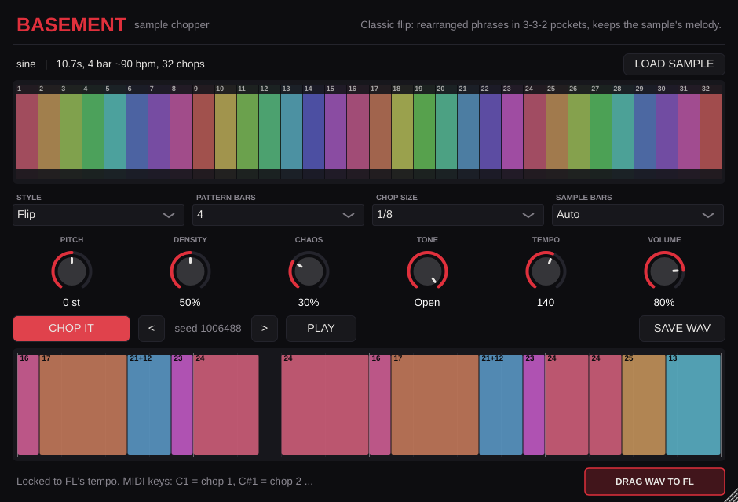

# BASEMENT — Sample Chopper

Underground rap için sample chop plugin'i (VST3 / AU / Standalone).
Sample'ı sürükle, **CHOP IT**'e bas, FL'in temposunda çalsın; beğendiğin flip'i WAV olarak playlist'e sürükle.



## Nasıl çalışır

1. **Sample yükle:** dalga formu alanına sürükle-bırak ya da **LOAD SAMPLE** (wav, mp3, aiff, flac).
   Plugin sample'ın kaç bar olduğunu tahmin eder (ekranda "4 bar ~90 bpm" gibi yazar). Yanlışsa **SAMPLE BARS**'ı elle seç.
2. Sample, **CHOP SIZE**'a göre dilimlenir (1/4, 1/8, 1/16 ya da **Transient** = vuruş noktalarından).
3. **CHOP IT** stile göre yeni bir chop pattern'i üretir. Pattern birkaç "anchor" chop etrafında döner ve
   `AABA'` gibi formlarla tekrar eder; o yüzden rastgele dilim yığını değil, hook gibi duyulur.
4. FL Play'deyken tempoya kilitli çalar. `<` `>` ile seed'ler arasında gez.
5. **DRAG WAV TO FL** → playlist'e bırak (1 loop, FL temposunda, kusursuz döngü). Ya da **SAVE WAV**.

## Stiller

| Stil | Ne yapar |
|---|---|
| **Flip** | Klasik flip: 3-3-2 cepli yeniden dizilmiş cümleler, sample'ın melodisi korunur |
| **Stutter** | Glitchy jerk / new-wave: stutter, roll, oktav zıplamaları (Chaos'u aç) |
| **Slowed** | Uzun, puslu, pitch'i düşürülmüş chop'lar (-4 st) |
| **Bounce** | Boşluklu, ritmik stab'lar — 808 ve hi-hat'e yer bırakır |
| **Original** | Chop yok: sample sırayla, tempona kilitli. A/B için |

## Kontroller

- **Pitch** — MPC usulü (hız ile) pitch, ±12 st. Underground için -2 ile -5 arası dene.
- **Density** — kısa chop'lar ve az boşluk ↔ uzun chop'lar ve nefes.
- **Chaos** — roll, oktav ve reverse chop olasılığı.
- **Tone** — low-pass; tozlu/boğuk ses için kıs.
- **Tempo** — sadece DAW çalmıyorken (Standalone / PLAY butonu) kullanılır.
- **MIDI** — C1 = chop 1, C#1 = chop 2 ... Klavyeyle/pad'le kendin de çalabilirsin.

Chop'lar arasında kısa crossfade var (MPC'deki mono pad gibi), kesimlerde tık sesi olmaz.

## Kurulum (Mac)

1. GitHub'da **Actions** → en üstteki yeşil ✓ build → en altta **Artifacts** → `Basement-macOS` indir.
2. Terminal:
   ```bash
   cd ~/Downloads && unzip -oq Basement-macOS.zip -d Basement-macOS; bash ~/Downloads/Basement-macOS/install-mac.sh
   ```
3. FL'i kapatıp aç → **Options → Manage plugins** → "Rescan previously verified plugins" işaretle → **Start scan**.

Windows: `Basement-Windows` içindeki `Basement.vst3`'ü `C:\Program Files\Common Files\VST3\` içine kopyala.

## Kaynaktan derleme

```bash
cmake -S . -B build -DCMAKE_BUILD_TYPE=Release
cmake --build build --config Release
ctest --test-dir build -C Release
```

Komut satırından chop denemek için: `./build/basement-chop sample.wav out/ [seed] [bpm]` her stil için bir WAV üretir.

## Proje yapısı

```
engine/Chop.cpp      Chop pattern motoru (saf C++): stiller, anchor'lar, formlar, roll/reverse/oktav
plugin/SampleData    Yükleme, bar/BPM tahmini, grid ve transient dilimleme
plugin/ChopSampler   Tıksız sampler: choke + crossfade, Hermite interpolasyon, host senkron zamanlama
plugin/PluginEditor  Dalga formu, chop şeridi, sürükle-bırak
engine/Generator.cpp Önceki MIDI melodi motoru (artık plugin'de değil; basement-cli ile duruyor)
```
